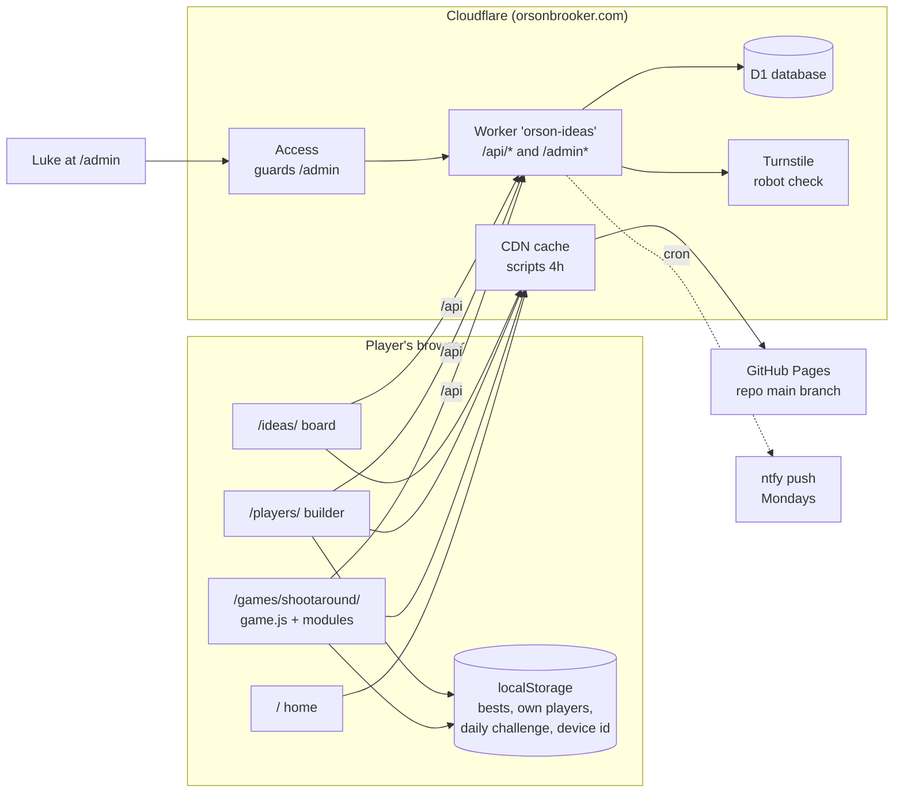
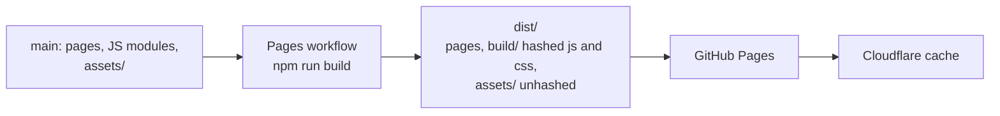
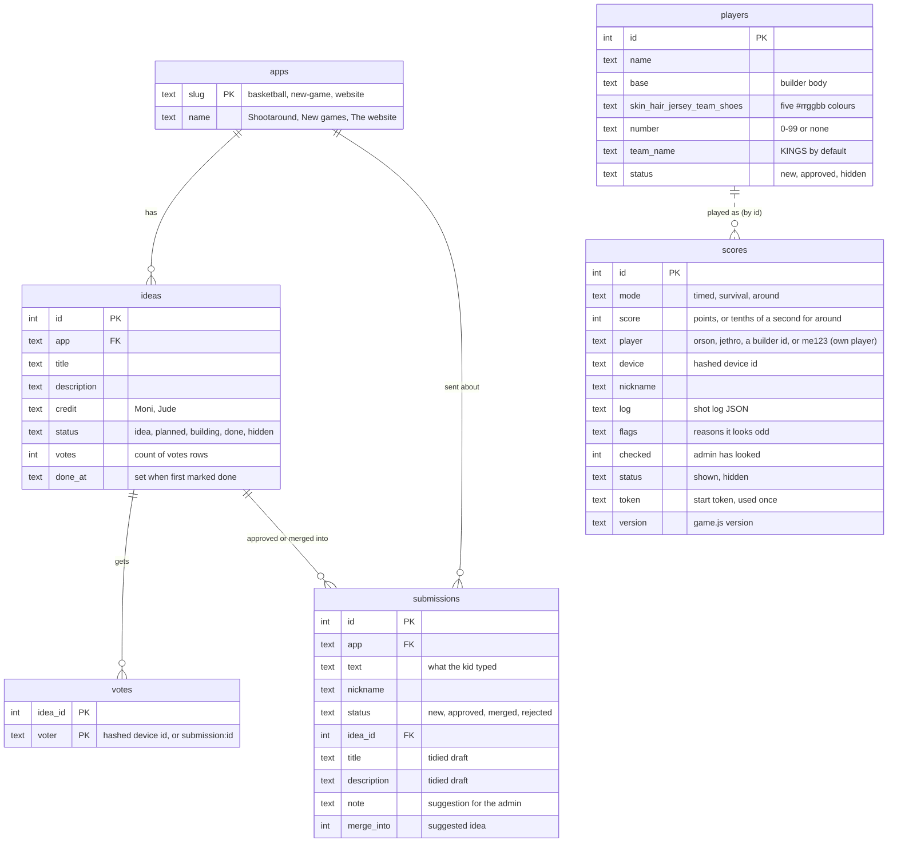
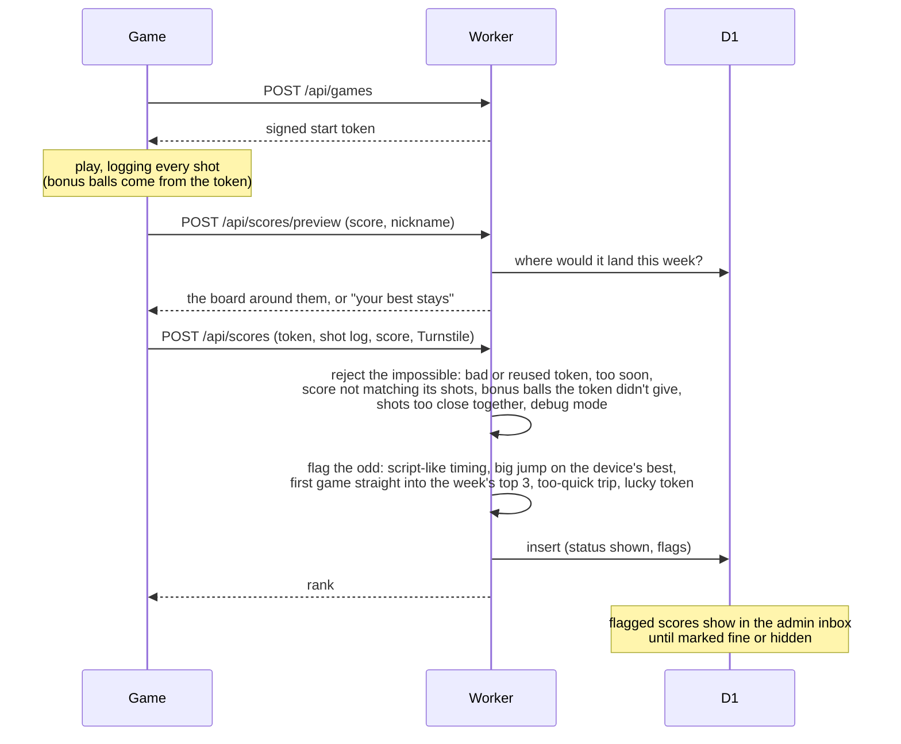
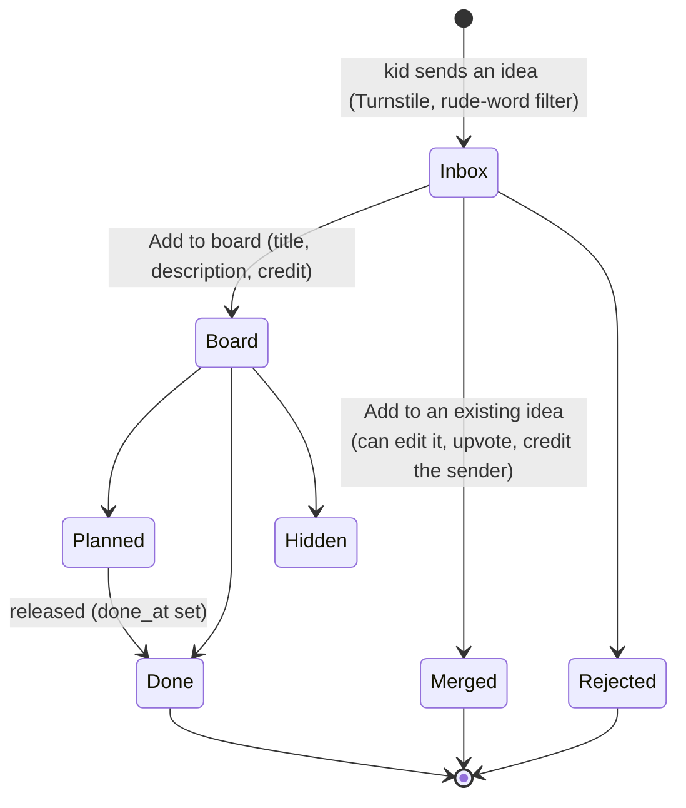
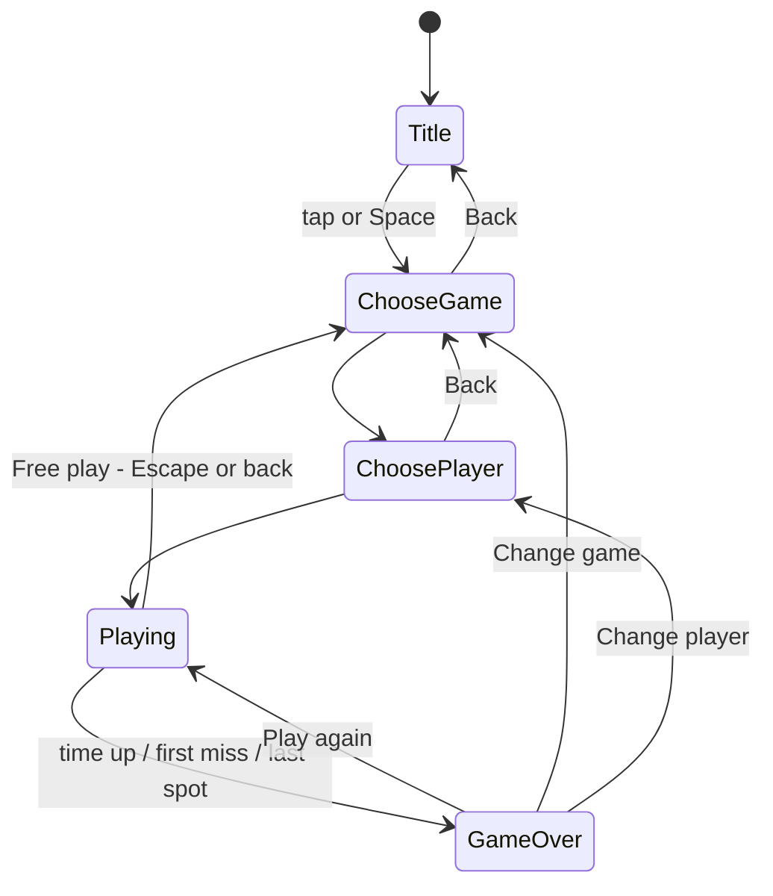
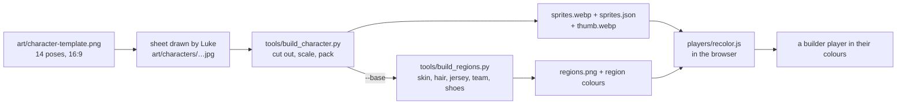
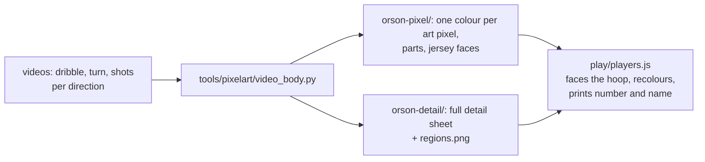

# Architecture

How orsonbrooker.com and Shootaround work, kept up to date as they change. Plans for where it's heading
are not here: those go in `notes/` (gitignored). When a change alters something below, update this file in
the same commit.

## The pieces

- **Static site:** plain JS modules built with Vite. On every push to `main`, the Pages workflow
  (`.github/workflows/pages.yml`) runs `npm run build` (`vite.config.js`) and publishes `dist/` to GitHub
  Pages, cached by Cloudflare. Each page keeps its URL; scripts and stylesheets get hashed names in
  `dist/build/`, so new code always gets past the cache, and everything fetched by URL at runtime
  (`assets/`, `icons/`, manifests, `robots.txt`, `sitemap.xml`, `CNAME`) is copied unhashed. The build puts
  the commit into the game as the version it sends with scores. The iOS app (Capacitor) can wrap the same
  `dist/`.

- **Worker** (`worker/src/index.ts`, admin UI in `worker/src/admin.html`): the only server. It answers the API
  and the admin page on the same domain as the site, so there's no cross-site setup in production.
- **Edge cache** (`worker/src/cache.ts`): public answers that are the same for everyone (the boards, score
  cards, approved players, config, the ideas list without a device) are kept in Cloudflare's cache for 30-60 s,
  keyed by the URL with only the parameters the handler reads. A new score or an admin change clears what it
  changed in that data centre; elsewhere it can be up to a minute old. Nothing personal or admin is cached.
- **D1:** one SQLite database, changed only through numbered files in `worker/migrations/`.

## Code map

| Area | Files | What it does |
|---|---|---|
| Game entry | `game.js` | Starts the game and wires the pieces below together: the one button (press, release), the screens' buttons, boot, `window.game` in `?debug`. |
| Engine | `engine/` | `court.js` the court in metres and `project()` onto the isometric art, 3-point line, random spots; `physics.js` fixed-step ball physics (`PHYSICS_STEP`), rim and backboard collisions, reported through callbacks; `loop.js` the frame loop; `input.js` tap/Space/hold, Escape, arrow keys in pickers, arrow keys and WASD steering the player in Free play; `draw.js` canvas helpers (ball sprites, banner, popups, wall scoreboard digits, shoe finder); `storage.js`. |
| Game in progress | `play/` | `state.js` the one shared `state` object, the player, shot timing, which mode is on (`mode()`), seeded randomness, which way Free play is being steered (`steering()`); `round.js` starting a game, shooting from the jump, makes and misses, the per-frame update (jogging between spots, and in Free play `steerPlayer()`: the screen direction turned into a court direction, kept on the floor in front of the backboard); `controls.js` Free play's touch joystick and shoot button (pixel circles, only on `pointer: coarse` screens, keeping their touches from the tap-anywhere button); `react.js` calls, popups, confetti, fire and the timing window, bonus balls, daily challenge stats; `scene.js` draws the court and the score; `players.js` the player list, sprite sheets, faces. |
| Modes | `modes/` (`timed.js`, `survival.js`, `around.js`, `free.js`, shared `points.js`) | Time attack, Sudden death, Around the World, Free play, one file each with the same shape (listed in `modes/index.js`): start and next spot, clock, make, miss, difficulty, scoreboard text, the result and how it ranks. The rest of the game asks `mode()` instead of checking which mode it is. The first three are `ranked` (in `MODES`, with a best, a leaderboard, a start token and the daily challenge). Free play isn't: no clock, no score sent, no game over; the player moves himself (`freeMove`) and shoots from wherever he stands, and it ends only when they leave (Escape or the back button, to choosing a game). |
| Screens | `screens/` | `base.js` showing one screen at a time, sound buttons; `menus.js` title, choose a game, choose a player; `panels.js` help and leaderboard; `over.js` game over. |
| Game content | `content/` | Tables: how each fire level and ball looks, the wall scoreboard art, the Around the World spots, Sudden death run calls and end-of-game calls. |
| Scoring rules | `shared/rules.js` | Fire levels and bonuses, bonus balls, points, modes, recounting a shot log. Used by the game and the Worker. |
| Scoring extras | `daily.js`, `content/looks.js` (`FIRE_LEVELS` adds each level's looks) | Daily challenge, how fire looks and widens the timing window. |
| Gameplay randomness | `rng.js`, `play/state.js` (`random()`) | Seeded streams (sfc32) for shot spots and aim wobble. |
| Leaderboard | `leaderboard.js` | Start tokens, the end-of-round board, sending scores, the board and player cards. |
| Sound | `audio.js`, `phrases.js`, `assets/voice/`, `assets/sfx/` | Music that builds, synthesised effects, recorded bounces, a sneaker squeak and footsteps (`tools/build_sfx.py` packs `art/sfx/`), announcer clips (device voice as fallback). |
| Effects | `fx.js`, `effects/`, `vendor/pixelfx/` | Chunky pixel effects layer over the court. |
| Players | `assets/characters/`, `players/recolor.js`, `players/builder.js`, `players/pixelkit.js` | Built-in sprites; builder bodies recoloured from region maps; sheets made from video (Orson): which way he faces the hoop from each spot (`faceHoop()` in `play/players.js`), his number and team name warped onto a face on his jersey (`pixelkit.js`). |
| Shared UI | `ui/` | Nav, icons, styled dialogs, form helpers. |
| Ideas widget | `feedback/` | The "Got an idea?" button on each page. |
| Server | `worker/src/`: `index.ts` (entry point and router), `ideas.ts`, `players.ts`, `scores.ts`, `scoring.ts`, `admin.ts`, `access.ts`, `cache.ts`, `notify.ts`, `util.ts` | Ideas, votes and submissions; players; start tokens, scores, the boards and score cards (`scores.ts`); the admin page and API; checking the Access sign-in token (`access.ts`); the edge cache for public reads (`cache.ts`); the weekly ntfy; shared helpers (JSON, CORS, hashing, rate limits, Turnstile, rude-word filter). `scoring.ts` checks a sent game against the rules, with no database; it and the small rules pulled out of the handlers are tested on their own (`worker/test/`). |
| Art and voice tools | `tools/` | Character sheets, region maps, announcer clips, icons, share images. |

## Domain model

Terms used across the code:

- **Player:** who you play as. *Built-in* (Orson, Jethro: `assets/characters/index.json`), *approved builder
  players* (`players` table, status `approved`, shown to everyone) and *own players* (made in the builder, kept
  in that browser only, ids like `me1793858104451`; their look travels with their scores as `base` + `colours`).
- **Device:** a random id kept in the browser, stored server-side only as a keyed hash. The leaderboard shows one
  row per device + player per mode, with the latest nickname.
- **Rate limits:** the `rate_limits` table counts calls to cheap routes (votes, the score preview) per hashed IP
  per day, one upsert a call, so even toggling a vote uses up the day's allowance. The weekly cron clears old days.
- **Shot log:** one entry per shot, `[seconds in, three (1/0), made (1/0), release timing, ball kind]`. Release
  timing is measured in green-zone widths from the top of the jump; `|t| <= 0.5` is "let go in the green". Ball
  kind is 0 normal, 1 money, 2 rainbow.
- **Start token:** signed by the Worker when a game starts (`<ms>.<nonce>.<hmac>`), used once. Bonus balls are
  decided from it, so the server can check them.
- **Fire levels:** 3 in a row +1 a basket, 6 (purple) +2, 10 (blue supernova) +3: `FIRE_RULES` in
  `shared/rules.js`. `content/looks.js` adds how each looks and how much it widens the timing window.
- **Seed:** the start token also seeds the game's gameplay randomness (`rng.js`): one stream for where he shoots
  from, one for each shot's aim wobble, so the same token and the same inputs give the same game. The streams
  are made at the game's first draw (the first release); if the token hasn't come back by then (or never does,
  offline) the game uses a random seed throughout. It's kept in `state.rngSeed`; `?debug` can set it with
  `window.game.setSeed()`. Effects, sounds and which announcer line plays stay on `Math.random`.
- **Feature launch dates:** `FEATURE_FROM` in the Worker. Stats for a feature only show for games played after it.

## How a score gets on the board

The game and the Worker use the same scoring rules from `shared/rules.js` (`recountScore`, `ballKind`,
`ballPoints`, `FIRE_RULES`, modes), so the server recounts a game exactly as the game scored it. The checks in
the middle are `checkGame` and `oddFlags` in `worker/src/scoring.ts`.

## How an idea becomes a feature

Kids upvote ideas on `/ideas/` (one vote per idea per device). The admin can move an idea to another game or
app, and edit any of its fields.

## The game's screens

Help and the leaderboard open over any of these and return to where they were.

## Players' art

Orson is made from generated videos instead (green screen, one move and direction each, listed in
`art/video/orson.json`):

- **Moves per direction:** the game's moves are named by facing (`dribble-bl`, `jump-b`, ...); `faceHoop()`
  picks back, back-left or left from where he stands, falling back to back-left, then the plain name.
- **Number and team name:** each frame has a four-cornered face laid on his jersey, smoothed across the
  move; the text is set flat in the pixel font and warped onto it, only where jersey shows
  (`players/pixelkit.js`). The full-detail sheet borrows the faces from its pixel-art twin.
  `tools/dev/check_prints.mjs` checks every frame keeps the print on the jersey.
- **Recolouring:** the full-detail sheet has a `regions.png` like the builder bodies; `?jersey=...&number=`
  on the game URL tries a kit on Orson.

## Going live

Database migration first, then the Worker (it may need the new table), then the site (it may need the new
Worker). Details in the `go-live` skill.
