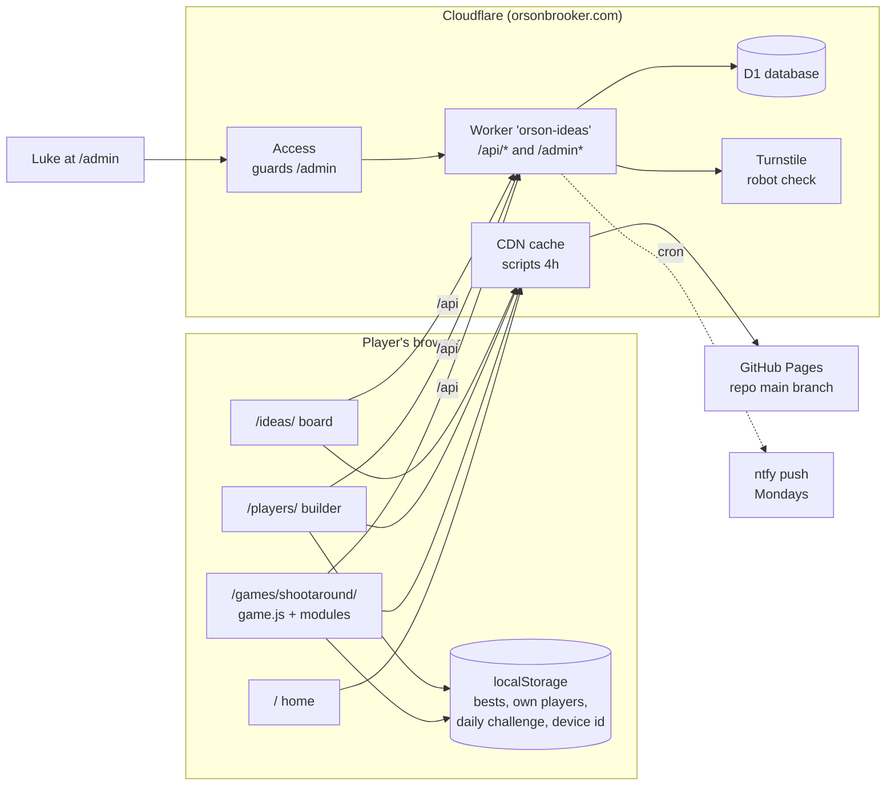
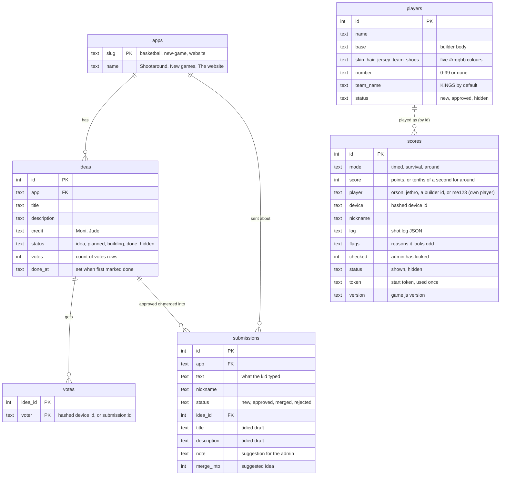
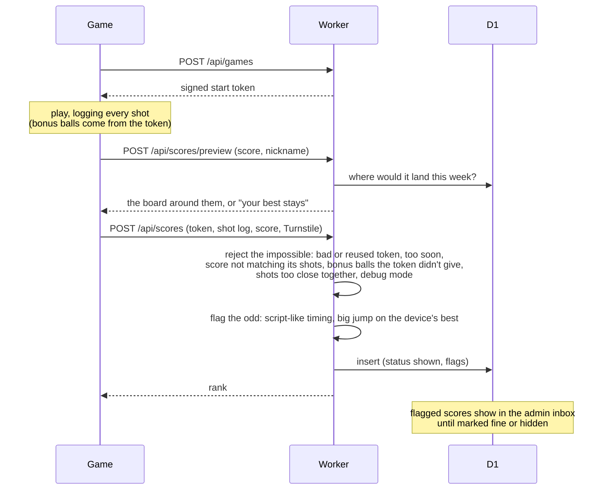
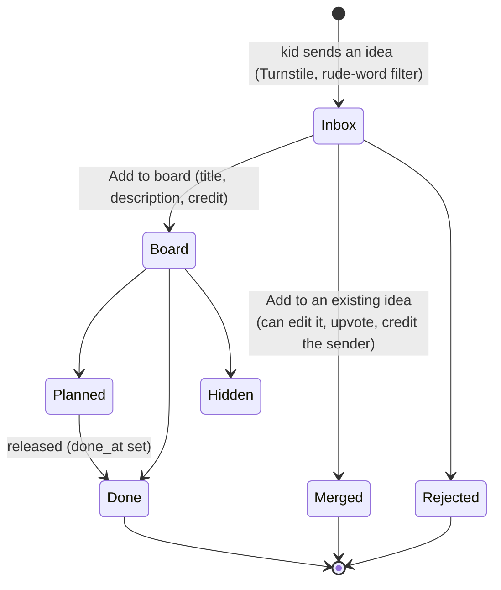
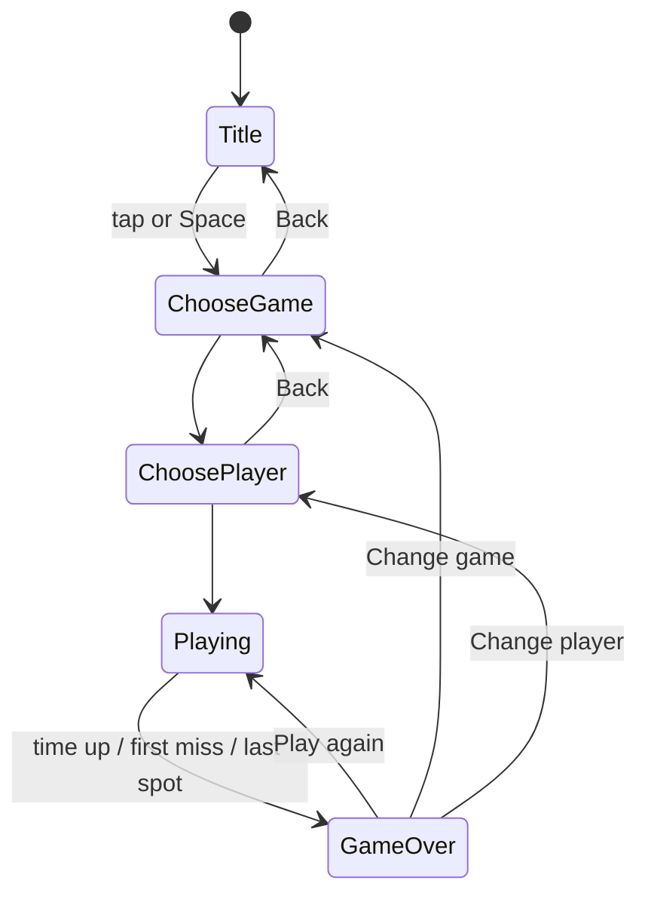
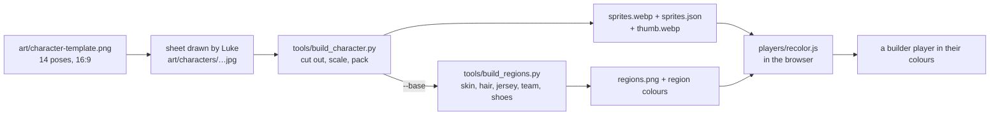

# Architecture

How orsonbrooker.com and Shootaround work, kept up to date as they change. Plans for where it's heading
are not here: those go in `notes/` (gitignored). When a change alters something below, update this file in
the same commit.

## The pieces

- **Static site:** plain JS modules with no build step, published from `main` by GitHub Pages and cached by
  Cloudflare. `tools/stamp_versions.py` (run by the pre-commit hook) adds `?v=<hash>` to every script and
  stylesheet so new code gets past the cache.
- **Worker** (`worker/src/index.ts`, admin UI in `worker/src/admin.html`): the only server. It answers the API
  and the admin page on the same domain as the site, so there's no cross-site setup in production.
- **D1:** one SQLite database, changed only through numbered files in `worker/migrations/`.

## Code map

| Area | Files | What it does |
|---|---|---|
| Game loop and physics | `game.js` | Fixed-step simulation (`PHYSICS_STEP`), ball in metres on an isometric court (`project()`), rim and backboard collisions, shot timing from the jump. |
| Modes | `game.js` (`MODES`, `around()`, `survival()`) | Time attack, Sudden death, Around the World. |
| Screens and input | `game.js` | Title, choose a game, choose a player, help, leaderboard, game over; tap/Space/hold, arrow keys in pickers. |
| Scoring rules | `shared/rules.js` | Fire levels and bonuses, bonus balls, points, modes, recounting a shot log. Used by the game and the Worker. |
| Scoring extras | `daily.js`, `game.js` (`FIRE_LEVELS` adds each level's looks) | Daily challenge, how fire looks and widens the timing window. |
| Leaderboard | `leaderboard.js` | Start tokens, the end-of-round board, sending scores, the board and player cards. |
| Sound | `audio.js`, `phrases.js`, `assets/voice/` | Music that builds, effects, announcer clips (device voice as fallback). |
| Effects | `fx.js`, `effects/`, `vendor/pixelfx/` | Chunky pixel effects layer over the court. |
| Players | `assets/characters/`, `players/recolor.js`, `players/builder.js` | Built-in sprites; builder bodies recoloured from region maps. |
| Shared UI | `ui/` | Nav, icons, styled dialogs, form helpers. |
| Ideas widget | `feedback/` | The "Got an idea?" button on each page. |
| Server | `worker/src/index.ts`, `worker/src/scoring.ts` | Ideas, votes, players, scores, admin API, weekly ntfy. `scoring.ts` checks a sent game against the rules, with no database, so it's tested on its own (`worker/test/`). |
| Art and voice tools | `tools/` | Character sheets, region maps, announcer clips, icons, share images. |

## Domain model

Terms used across the code:

- **Player:** who you play as. *Built-in* (Orson, Jethro: `assets/characters/index.json`), *approved builder
  players* (`players` table, status `approved`, shown to everyone) and *own players* (made in the builder, kept
  in that browser only, ids like `me1793858104451`; their look travels with their scores as `base` + `colours`).
- **Device:** a random id kept in the browser, stored server-side only as a keyed hash. The leaderboard shows one
  row per device + player per mode, with the latest nickname.
- **Shot log:** one entry per shot, `[seconds in, three (1/0), made (1/0), release timing, ball kind]`. Release
  timing is measured in green-zone widths from the top of the jump; `|t| <= 0.5` is "let go in the green". Ball
  kind is 0 normal, 1 money, 2 rainbow.
- **Start token:** signed by the Worker when a game starts (`<ms>.<nonce>.<hmac>`), used once. Bonus balls are
  decided from it, so the server can check them.
- **Fire levels:** 3 in a row +1 a basket, 6 (purple) +2, 10 (blue supernova) +3: `FIRE_RULES` in
  `shared/rules.js`. `game.js` adds how each looks (`FIRE_LOOKS`) and how much it widens the timing window.
- **Feature launch dates:** `FEATURE_FROM` in the Worker. Stats for a feature only show for games played after it.

## How a score gets on the board

The game and the Worker use the same scoring rules from `shared/rules.js` (`recountScore`, `ballKind`,
`ballPoints`, `FIRE_RULES`, modes), so the server recounts a game exactly as the game scored it. The checks in
the middle are `checkGame` and `oddFlags` in `worker/src/scoring.ts`.

## How an idea becomes a feature

Kids upvote ideas on `/ideas/` (one vote per idea per device). The admin can move an idea to another game or
app, and edit any of its fields.

## The game's screens

Help and the leaderboard open over any of these and return to where they were.

## Players' art

## Going live

Database migration first, then the Worker (it may need the new table), then the site (it may need the new
Worker). Details in the `go-live` skill.
