# Architecture

How orsonbrooker.com and Shootaround work, kept up to date as they change. Plans for where it's heading
are not here: those go in `notes/` (gitignored). When a change alters something below, update this file in
the same commit.

## The pieces

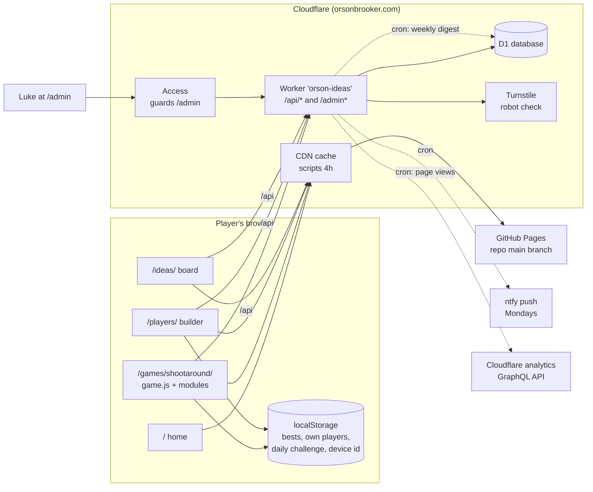

- **Static site:** plain JS modules built with Vite. On every push to `main`, the Pages workflow
  (`.github/workflows/pages.yml`) runs `npm run build` (`vite.config.js`) and the Worker tests (a push that
  breaks them doesn't publish; the rest of `npm run check` runs locally) and publishes `dist/` to GitHub
  Pages, cached by Cloudflare. Each page keeps its URL; scripts and stylesheets get hashed names in
  `dist/build/`, so new code always gets past the cache, and everything fetched by URL at runtime
  (`assets/`, `icons/`, manifests, `robots.txt`, `sitemap.xml`, `CNAME`) is copied unhashed. The pixel font is self-hosted (`@fontsource/press-start-2p`,
  bundled through `styles.css`; a fixed-name copy in `fonts/` for the admin page): no font service sees visitors. The build puts
  the commit into the game as the version it sends with scores. The iOS app (Capacitor) can wrap the same
  `dist/`.

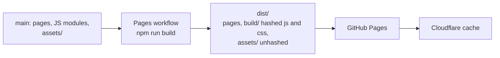
- **Offline (service worker):** `sw.js`, registered by `offline.js` on every page once it has loaded (not
  in the iOS app, which carries its files, nor under `npm run dev`). The build writes it into `dist/` with
  the deploy's `/build/` files, commit and build time, so each deploy is a new worker. Code (`/build/*`) and
  stamped files (`?v=` or a hash in the name) come from the cache, else are fetched once and kept; a newer
  stamp replaces the older one. Pages and unstamped JSON lists go to the network first and use the cached
  copy only when offline, so a deploy shows on the next online visit even if the worker itself is stale.
  Other unstamped files (the court, the hoop) are kept until the next deploy. `/api/*`, `/admin` and other
  sites are never touched (so feature flags, `/api/flags`, always come from the server, or the copy
  `flags.js` kept). After the title screen the game asks it to keep every player's and builder body's
  sheets, at the size this device draws them, and the announcer's and sounds' clips, so any player can be
  chosen offline. Only what's out is kept ahead: the lists already follow the flags (drawn Curly and Buns
  until `videokids`, Orson's old art until `orsonvideo`), and gear and heads are only fetched when worn. A score from an offline game says
  "Scores need the internet." instead of sending.

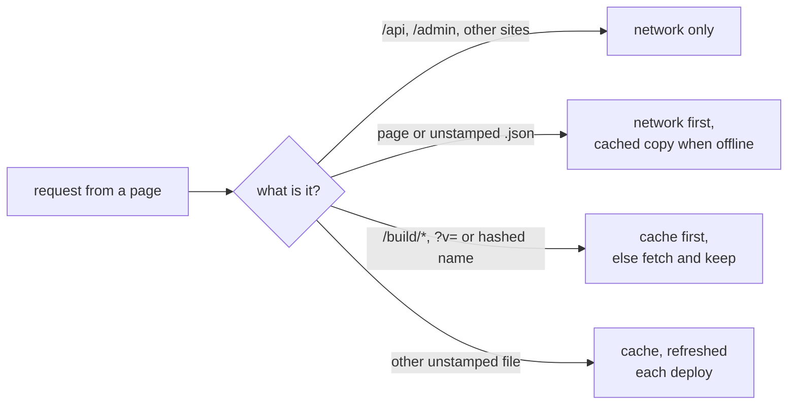
- **Worker** (`worker/src/index.ts`, admin UI in `worker/src/admin.html`): the only server. It answers the API
  and the admin page on the same domain as the site, so there's no cross-site setup in production. The admin
  page has one address per section (`/admin` is the inbox, then `/admin/ideas`, `/admin/players`,
  `/admin/scores`, `/admin/words`, `/admin/stats`, `/admin/flags`), all the same page behind the same sign-in check. It draws players front and back with
  the site's own `players/recolor.js`, which the build copies to a fixed address for it.
- **Edge cache** (`worker/src/cache.ts`): public answers that are the same for everyone (the boards, score
  cards, approved players, config, feature flags, the ideas list without a device) are kept in Cloudflare's cache for 30-60 s,
  keyed by the URL with only the parameters the handler reads. A new score or an admin change clears what it
  changed in that data centre; elsewhere it can be up to a minute old. Nothing personal or admin is cached.
- **D1:** one SQLite database, changed only through numbered files in `worker/migrations/`.

## Code map

| Area | Files | What it does |
|---|---|---|
| Game entry | `game.js` | Starts the game and wires the pieces below together: the one button (press, release), the screens' buttons, boot, `window.game` in `?debug`. |
| Engine | `engine/` | `court.js` the court being played (from `content/courts.js`) in metres and `project()` onto the isometric art, 3-point line, random spots; `physics.js` fixed-step ball physics (`PHYSICS_STEP`) with the court's gravity and wind, rim and backboard collisions, reported through callbacks; `loop.js` the frame loop; `input.js` tap/Space/hold, Escape, arrow keys in pickers, arrow keys and WASD steering the player in Free play; `draw.js` canvas helpers (ball sprites, banner, popups, wall scoreboard digits, shoe finder); `storage.js`. |
| Game in progress | `play/` | `state.js` the one shared `state` object, the player, shot timing, which mode is on (`mode()`), seeded randomness, which way Free play is being steered (`steering()`); `round.js` starting a game, shooting from the jump, makes and misses, the per-frame update (jogging between spots, and in Free play `steerPlayer()`: the screen direction turned into a court direction, kept on the floor in front of the backboard); `controls.js` Free play's touch joystick and shoot button (pixel circles, only on `pointer: coarse` screens, keeping their touches from the tap-anywhere button); `react.js` calls, popups, confetti, fire and the timing window, bonus balls, daily challenge stats; `scene.js` draws the court and the score; `players.js` the player list, sprite sheets, faces, a higher jump; `court.js` switching courts (measurements, physics, art); `replay.js` instant replays (recording each release, picking the best shot, playing it again). |
| Modes | `modes/` (`timed.js`, `survival.js`, `around.js`, `horse.js`, `threes.js`, `free.js`, shared `points.js`) | Time attack, Sudden death, Around the World, 3-point contest, HORSE (pass and play, no leaderboard), Free play, one file each with the same shape (listed in `modes/index.js`): start and next spot, clock, make, miss, difficulty, scoreboard text, the result and how it ranks. The rest of the game asks `mode()` instead of checking which mode it is. A mode with a feature flag (see Feature flags) only shows once it's switched on, or with `?flags=` or `?debug`: `modeShown()` in `modes/index.js` hides its card, leaderboard tab and help, and `modeReleased()` keeps a game only tried that way from being sent. The 3-point contest waits for its rack art (brief in `art/three-point-contest.md`); Free play is new. Free play (`ranked: false`) has no clock, no score sent, no daily challenge and no game over; the player moves himself (`freeMove`) and shoots from wherever he stands (within 2 m of the hoop a shot is a dunk: `startDunk()` in `round.js` leaps him up to the rim, slams the ball through and drops him in front of it), and it ends only when they leave (Escape or the back button, to choosing a game). |
| Moving green zone | `play/zone.js`, `zoneCenter()` in `play/react.js` | A mechanic a mode switches on with `zoneShift()`: the green part of the timing bar moves to a new place each shot (from the seeded "zone" stream), and a release is timed from the green's middle. On in Sudden death (from 5 in a row, further as the run grows), Around the World (gently) and the 3-point contest. |
| Screens | `screens/` | `base.js` showing one screen at a time, sound buttons; `menu.js` the one menu (the game, then the website's pages, left out in the iOS app); `pause.js` pausing a game (keep playing, start again, quit); `menus.js` title, choose a game, choose a player (or several, for pass and play); `horse.js` the turn screen between HORSE shots; `panels.js` help and leaderboard; `shop.js` the shop (ball styles, pairing another device); `over.js` game over (the Replay button, the coins a game earned). |
| Game content | `content/` | Tables: the courts (`courts.js`), what each player is good at (`attributes.js`), how each fire level and ball looks, the wall scoreboard art, the Around the World spots, the 3-point contest's racks (`threes.js`, with where its art goes), the HORSE spots and spot map, Sudden death run calls and end-of-game calls. |
| Scoring rules | `shared/rules.js` | Fire levels and bonuses, bonus balls, points, modes, recounting a shot log, coins for a game (`coinsFor`). Used by the game and the Worker. |
| Shop and saved progress | `shared/shop.js`, `shared/save.js`, `progress.js` | The ball styles coins buy (colours drawn in code, prices the Worker checks); what else travels with progress and how two devices' copies merge (shared with the Worker); the game's side of saved progress: this device's key, the last known coins and ball, the progress API. |
| Scoring extras | `daily.js`, `content/looks.js` (`FIRE_LEVELS` adds each level's looks) | Daily challenge, how fire looks and widens the timing window. |
| Gameplay randomness | `rng.js`, `play/state.js` (`random()`) | Seeded streams (sfc32) for shot spots, aim wobble and where a moving green zone goes. |
| Leaderboard | `leaderboard.js` | Start tokens, the end-of-round board, sending scores, the board and player cards. |
| Sound | `audio.js`, `phrases.js`, `assets/voice/`, `assets/sfx/` | Music that builds, synthesised effects, recorded bounces, a sneaker squeak and footsteps (`tools/build_sfx.py` packs `art/sfx/`), announcer clips (device voice as fallback); lines about the player in he and she versions. |
| Effects | `fx.js`, `effects/`, `vendor/pixelfx/` | Chunky pixel effects layer over the court. |
| Players | `assets/characters/`, `players/recolor.js`, `players/builder.js`, `players/pixelkit.js`, `players/stretch.js` | Built-in sprites; builder bodies recoloured from region maps; sheets made from video (Orson): which way he faces the hoop from each spot (`faceHoop()` in `play/players.js`), his number and team name warped onto a face on his jersey (`pixelkit.js`). |
| Shared UI | `ui/` | Nav (the site bar on every page but the game), icons, styled dialogs, form helpers. |
| Ideas widget | `feedback/` | The "Got an idea?" button on each page. |
| Server address | `api.js` | Where the API is: this site's `/api`, the local Worker on localhost, or the live site from the iOS app. |
| iOS app | `ios/`, `capacitor.config.json`, `tools/app/prepare.mjs` | The same pages bundled into an app with Capacitor, opening on the game. |
| Haptics | `haptics.js` | A buzz on baskets and fire: Capacitor's Haptics in the app, the Vibration API on Android, and on iPhone Safari (no Vibration API) a hidden `<input switch>` flipped by clicking its label, which plays the system tick (iOS 18+). |
| Server | `worker/src/`: `index.ts` (entry point and router), `ideas.ts`, `players.ts`, `scores.ts`, `scoring.ts`, `progress.ts`, `admin.ts`, `access.ts`, `cache.ts`, `flags.ts`, `notify.ts`, `digest.ts`, `util.ts` | Ideas, votes and submissions; players; start tokens, scores, the boards and score cards (`scores.ts`); coins, buying and pairing (`progress.ts`); the admin page and API; checking the Access sign-in token (`access.ts`); the edge cache for public reads (`cache.ts`); feature flags (`flags.ts`); the weekly ntfy; shared helpers (JSON, CORS, hashing, rate limits, Turnstile, rude-word filter). `scoring.ts` checks a sent game against the rules, with no database; it and the small rules pulled out of the handlers are tested on their own (`worker/test/`). |
| Art and voice tools | `tools/` | Character sheets, region maps, announcer clips, icons, share images. |

## Domain model

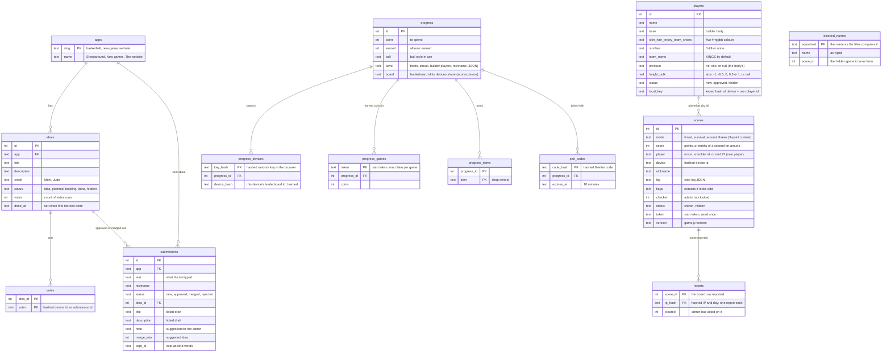

Terms used across the code:

- **Player:** who you play as. *Built-in* (Orson: `assets/characters/index.json`), *approved builder
  players* (`players` table, status `approved`, shown to everyone) and *own players* (made in the builder, kept
  in that browser only, ids like `me1793858104451`; their look travels with their scores as `base` + `colours`).
- **Size (build):** a builder player's `{ height, bulk }` from the builder's sliders, each -1, -0.5, 0, 0.5
  or 1 (0 is the body as drawn). Sent with the player (`build`), kept in the `players` table's `height` and
  `bulk` (null when none was sent) and returned as `build` (or null) by `GET /api/players`, so an approved
  player is the same size for everyone; own players keep it on the device.
- **Builder** (`players/`): four tabs under a preview that stays on screen: *Character* (skin and hair
  colour, with every body below as a card in those colours and size, so kids compare them before picking),
  *Body* (height and build, for kids made from video), *Team* (`players/teams.js`: the teams everyone has,
  Kings first, or your own, kept on the device as `orson-hoops-my-teams`; each has a home and an away kit of
  jersey, shorts and trim; plus the player's number) and *Gear* (shoe colour, and the shop's ball styles
  through `progress.js`: owned ones are picked straight away, others are tried on in a kid from video's hands
  with Buy or Cancel covering the gear). *Done* opens a sheet with
  the nickname, "Play as them now" and "Send to Orson". The cards load every body in the background. Own players have an edit pencil in the game's picker:
  `/players/?edit=<id>` loads them (body, colours, team and kit, number, size) and saving keeps their id, even
  under a new name; one already sent (`sent` in the save) is told that sending again sends the new look. A send carries the own
  player's id and the device id (as `local_key`, a keyed hash), so sending the same player again replaces its
  request while it still waits (all checks first, then the swap in one batch); once approved, the new look waits
  as a request of its own.
- **Pronoun:** whether a player is a "he" or a "she", for the announcer's lines. Built-in players have it in
  `index.json` ("he"); builder players get their body's (`pronoun` in `assets/characters/bases/index.json`:
  ponytail and buns are "she", the rest "he"), unless the admin sets one of their own (the `players` table's
  `pronoun`, null meaning "the body's"). `phrases.js` writes lines about the player for a he,
  with a hand-written she version of each in `SHE`; `pickPhrase(category, pronoun)` uses the she version for a
  she, and skips those lines altogether for a player with neither. The pronoun is the player shooting now
  (`player.pronoun`, set by `useCharacter`), so in HORSE it follows each turn.
- **Device:** a random id kept in the browser, stored server-side only as a keyed hash. The leaderboard shows one
  row per device + player per mode, with the latest nickname (devices joined by a pairing code count as one).
- **Report:** anyone can tap the flag on someone else's leaderboard row (the board panel and the game-over
  board, never their own rows) to say the name isn't friendly: `POST /api/reports` with `{ scoreId }` and the
  X-Device header. One `reports` row per score per hashed IP (and day), so repeats are no-ops; a device
  reporting its own row is ignored; 30 a day per IP. Reported scores still on the board go to the top of the
  admin inbox ("Reported names", with the count) and the weekly ntfy count, until the admin renames the player,
  hides that game or presses "Looks fine" (`name-ok`), which mark the reports `cleared`. Rename and Looks fine
  clear every report on that device and player's games (one row, one name); Hide clears that game's only, so
  if their next best game shows with the same name it can be reported again.
- **Blocked name:** hiding a game while its name has open reports ("Hide and block name") adds the name to
  `blocked_names`, squashed like the rude-word filter (lower-case letters, look-alikes swapped back; names under
  3 letters aren't added). From then on `isUnfriendly` (`util.ts`) turns away any typed text containing it
  (nicknames, players, team names, ideas, `/api/check`), on top of the rude-word filter; each Worker instance
  keeps the list for a minute. The admin's Scores page lists them, with "Allow again".
- **Rate limits:** the `rate_limits` table counts calls to cheap routes (votes, the score preview, reports) per hashed IP
  per day, one upsert a call, so even toggling a vote uses up the day's allowance. The weekly cron clears old days.
- **Shot log:** one entry per shot, `[seconds in, three (1/0), made (1/0), release timing, ball kind]`. Release
  timing is measured in green-zone widths from the middle of the green (the top of the jump, unless the mode
  moves it); `|t| <= 0.5` is "let go in the green". Ball kind is 0 normal, 1 money, 2 rainbow. In a 3-point
  contest every shot is a three and the money balls are each rack's last ball (`contestBall`), not the token's.
- **Start token:** signed by the Worker when a game starts (`<ms>.<nonce>.<hmac>`), used once. Bonus balls are
  decided from it, so the server can check them.
- **Fire levels:** 3 in a row +1 a basket, 6 (purple) +2, 10 (blue supernova) +3: `FIRE_RULES` in
  `shared/rules.js`. `content/looks.js` adds how each looks and how much it widens the timing window.
- **Seed:** the start token also seeds the game's gameplay randomness (`rng.js`): one stream for where he shoots
  from, one for each shot's aim wobble, one for where a moving green zone goes (each stream is seeded by its
  name, so adding one doesn't change what the others give), so the same token and the same inputs give the same game. The streams
  are made at the game's first draw (the first release); if the token hasn't come back by then (or never does,
  offline) the game uses a random seed throughout. It's kept in `state.rngSeed`; `?debug` can set it with
  `window.game.setSeed()`. Effects, sounds and which announcer line plays stay on `Math.random`.
- **Instant replay:** after any game, the game-over screen's Replay button plays the game's best shot again
  in slow motion (a buzzer beater, else the most points, else a swish; the later one on a tie), then goes
  back. Nothing is recorded frame by frame: at each release `play/replay.js` keeps who shot from where, how
  far into the jump they let go, the ball's start (position and speed in court metres), its fire level and
  kind (`state.replayShots`, never sent). The physics has a fixed step and balls don't touch each other, so
  stepping the same start again gives the same flight exactly; `window.game.checkReplays()` in `?debug`
  re-flies every shot and checks each goes in or out as it did. A replay changes nothing about the score,
  the shot log or what's sent.
- **Saved progress and coins:** coins are earned only by playing, never bought: 1 a basket, 2 while on fire,
  5 for a money or rainbow ball that goes in (`coinsFor` in `shared/rules.js`). As a game ends (not in
  `?debug`) the game sends it to `POST /api/progress/games` with its start token and shot log; the Worker
  checks it exactly like a leaderboard score (`checkGame`, the token's age) and adds the coins once per token,
  whether or not the score ever goes on the board. A finished HORSE match has no score, so it earns a flat
  amount instead (`HORSE_MATCH` in `shared/rules.js`), checked only by the token's age (at least 30 seconds),
  for the device it was played on; a match quit from the pause earns nothing.
  The first coins make a `progress` and give the device a random key (`orson-progress-key` in the browser; the server keeps only a keyed hash). The game never
  throws the key away, whatever an answer says (a 404 can come from a wrong route as easily as from the
  server): it's the only way back to the coins and balls. No names,
  emails or passwords. Coins buy ball styles (`shared/shop.js`; the everyday ball's look, while money and
  rainbow balls keep theirs so they stand out). To carry progress to another device, one device asks for a
  pairing code (`/pair`: 8 letters and numbers, works once, for 10 minutes) and the other types it in
  (`/join`, 15 tries a day per IP); anything the joining device already had is added in, so nothing's lost.
  A lost device's coins can't be got back. All progress routes are POSTs with the key in the body (never in
  a URL) and are rate limited per IP.
- **What else travels with progress:** personal bests, the daily challenge streak, players made in the
  builder and the leaderboard nickname (`shared/save.js`). Each kept where it always was in the browser;
  `progress.js` gathers them into a save and sends it with the progress calls that read or earn (`/progress`
  at boot and when the shop opens, `/games`, `/join`). The Worker tidies it (known shapes and sizes only,
  rude names dropped), merges it into the stored copy (`progress.save`) and sends the result back, which the
  game merges in again and writes back to each place. Merging never loses anything: the better best (the
  fastest for Around the World), the streak from the device that did a challenge last, both devices' players
  (newest first, up to 6, one per name; removed ones are remembered so they stay gone), the nickname typed
  most recently. Players arriving from another device join the picker straight away. The save is only ever
  sent back to devices holding the key.
- **Leaderboard rows follow progress too:** the progress calls send the device's leaderboard id, and the
  Worker notes its hash against the key (`progress_devices.device_hash`). A progress has one shared id
  (`progress.board`, its first device's); `boardOf` in `scores.ts` sends every joined device's games there,
  and its own-row checks (the preview, not reporting yourself) use it too. Joining moves the joining device's
  earlier rows (and those of any devices it was already joined with) onto the shared id, so each player
  shows once, at their best across all their devices, with the latest nickname. A device with no progress
  keeps its own rows, as before. Each progress call also moves any rows still on the device's own id
  across (a score sent while it was joining), and a device's id is linked to one key only (its newest).
- **Two joins at once:** a join merges one progress into another in one batch whose every step only runs
  while both still exist. If another join merged either away a moment before (two devices typing each
  other's codes at once), nothing moves and the device is asked to get a new code (409), so no coins or
  devices end up in a progress that's gone.
- **Feature launch dates:** `FEATURE_FROM` in the Worker. Stats for a feature only show for games played after it.

## Courts

A court is an entry in `content/courts.js`: its art (the court image and the hoop front drawn over the ball),
how the art maps to metres (origin, one metre along each floor direction, pixels per metre of height), the room's
size, the rim and backboard, the painted 3-point line (distance every 10 degrees, since it isn't a circle), the
default spot, and physics settings (gravity, optional wind). `engine/court.js` and `engine/physics.js` export
the active court's numbers as live bindings (`RIM`, `BOARD`, `GRAVITY`, ...), so the rest of the code reads
them as before; `play/court.js` `useCourt(id)` switches all of it (and the art) at once. Players only get the
gym for now. The test courts (`test: true`, the gym with low gravity or wind) are only reachable from `?debug`:
`await window.game.setCourt("gym-low-gravity")` before starting a game. A new court needs its own art, and a
look at the Around the World spots (`content/around.js`), which are placed round the hoop by angle and distance.

## Player attributes

What each player is good at, in `content/attributes.js` (`PLAYER_ATTRIBUTES`, by player id): `timing` (the green
zone's width, times this), `jump` (metres higher at the top of the jump: drawn higher, and the ball leaves from
there) and `three` (on a 3-pointer, timing mistakes and wobble are divided by this). Everyone is neutral
(`timing: 1, jump: 0, three: 1`, exactly how the game always played) until values are set there; players made on
a device are always neutral. The picker shows a player's skills only when they have some. The server needs no
change: it checks scores from the shot log, and the release timing in the log is measured in that player's own
green-zone widths.

## Feature flags

Things that are built but not out yet are hidden behind a feature flag until Luke switches them on, so
`main` can ship while they're finished. No outside service: the list is `shared/flags.js` (a key, a name,
what it hides, and the modes or builder bodies it covers), and the `flags` table (`0022_flags.sql`) holds
the ones switched on or off, and which idea each delivers. A flag with no row is off.

- **Admin:** the Flags section (`/admin/flags`) lists every flag with what it hides, its idea and a switch
  (`GET` and `POST /api/admin/flags`, behind Access and the token check like every admin change). Each idea
  on the Ideas section has the same link from its side.
- **Ideas:** a flag can be linked to the idea it delivers (optional: many ideas won't map to one flag, and
  flags like `orsonvideo` don't come from an idea). While the flag is off, `GET /api/ideas` marks the idea
  `coming_soon` and the board shows "Coming soon" (never the flag's name). Switching the flag on marks the
  idea done and sets its `done_at` if it has none, so there's no separate step; a hidden idea stays hidden.
- **Public:** `GET /api/flags` answers `{ flags: { key: true/false } }`, edge-cached like the boards (a change
  clears it here; elsewhere it's up to a minute old).
- **Game and builder:** `flags.js` loads them once as the page starts (waiting up to 1.5 s), keeps a copy
  on the device for offline (the service worker never caches `/api`), and falls back to that copy, else to
  everything off, so nothing unreleased leaks. `flagOn(key)` says whether to show it; `released(key)` whether
  it's really out (so what it sends will count). For testing, `?flags=threepoint,freeplay` (or `?flags=all`, or
  `?flags=none`) shows exactly those for the rest of the browser tab (kept in sessionStorage, as the
  game's links drop the query; `?flags=server` ends it), whatever the server has on, and `?debug` turns on all of them unless it has a `?flags=` of its own
  (`?debug&flags=none` is test mode with everything off); the server still refuses what they'd send.
- **Server:** the Worker refuses a score, a preview or coins for a mode whose flag is off
  (`requireModeOut`), a builder player with a hidden body (`requireBodyOut`), and a player with a size while
  `videokids` is off. It reads the table at most every 10 s per isolate.

The flags now:
- `threepoint` (the 3-point contest) and `freeplay` (Free play): their cards, tabs and help.
- `videokids` (Curly and Buns from video, with their sizes, shirt prints and jogging): off,
  `useDrawnKids()` in `players/recolor.js` gives them their earlier drawn bodies and the builder has no Body tab.
- `gear` (what kids from video wear; only shows with `videokids`).
- `orsonvideo` (Orson from video, with turning, jogging between shots and picking the dribble back up): off,
  `loadRoster()` in `play/players.js` gives him `assets/sprites.webp`, his earlier art.
- `layered` (builder bodies on Orson's moving body, `players/layered.js`).

Jogging between shots, facing the hoop from each side and the extra moves aren't flagged on their own: the
game only does them when the player's sheet has those moves (`canJog()`, `hasMove()`), so with `videokids`
and `orsonvideo` off every player moves as before. To retire a flag once something is out for good, take out
its checks, then its entry. Anything a flag reveals that scores or shows on a card still follows
`FEATURE_FROM` in `worker/src/scores.ts`: it counts from when it went live.

## Admin stats

The admin's Stats tab (`/admin/stats`, `worker/src/stats.ts`) shows the last 30 days of use and feature
adoption, worked out from what's already saved, so nothing new is collected from players and nothing goes to
another service:

- **Games** are the coin claims in `progress_games` (every finished game played online, HORSE included).
- **Saves** stand in for players: one `progress` is a device, or devices joined with a code. Active saves
  today, this week and this month; saves that came back on another day; saves made 1 to 5 weeks ago that
  played again a week after their first game.
- **Features** are counted over the saves that played: on a leaderboard (`scores.device = progress.board`),
  daily challenge (the save's `daily.done`), bought or using a ball, made a player (the save's `players`),
  joined with a code (more than one `progress_devices` row), played HORSE. Leaderboard sends add how people
  play (input), who they play as and which game versions are about.
- **Page views** come from Cloudflare's own analytics (sampled, no cookies). Cloudflare keeps them about a
  month, so the daily cron (00:30 UTC) copies each page's views and visits into `page_views` with a token
  that can only read this zone's analytics (`CF_ANALYTICS_TOKEN`). Working out the stats copies them too
  (from the last day copied to today), so a new day shows straight away; if Cloudflare fails, the page says
  why and shows the rest.

Only totals are shown, never one save's history. It's admin-only (Access plus the token check), indexed by
day (`0016_stats.sql`), and the answer is reused for 5 minutes, so the cost doesn't grow with players.

## How a score gets on the board

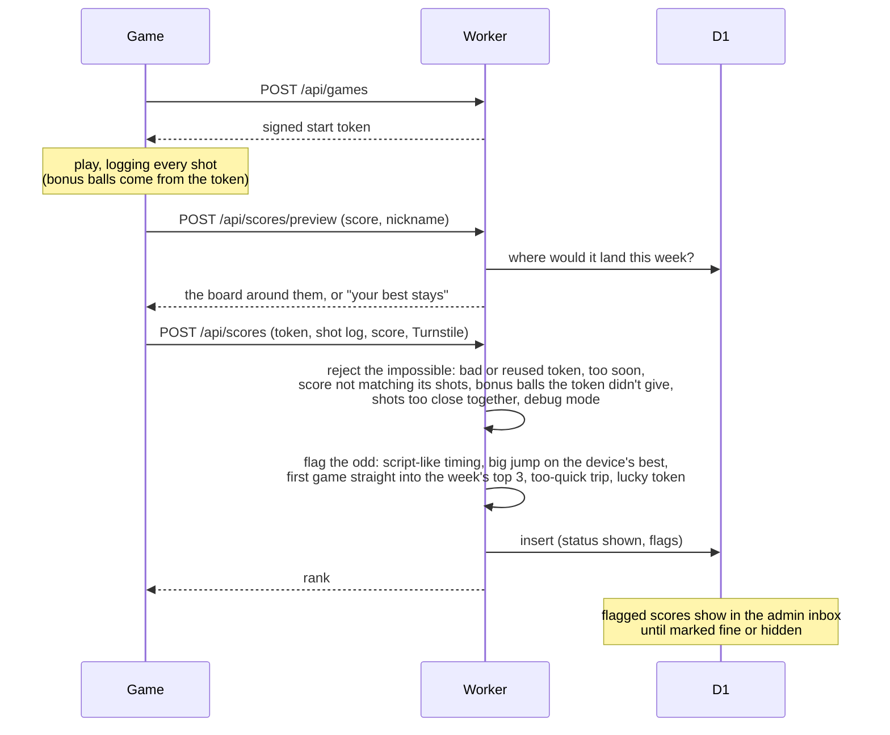

The game and the Worker use the same scoring rules from `shared/rules.js` (`recountScore`, `ballKind`,
`ballPoints`, `FIRE_RULES`, modes), so the server recounts a game exactly as the game scored it. The checks in
the middle are `checkGame` and `oddFlags` in `worker/src/scoring.ts`.

In the admin's Scores tab a score can be hidden, kept, or renamed: a new nickname (checked like a player's
own) goes on every game by that device and player, since the board shows them as one row. Names someone
reported (see **Report** above) show in the inbox with the rename box open and a "Looks fine" button.

## How an idea becomes a feature

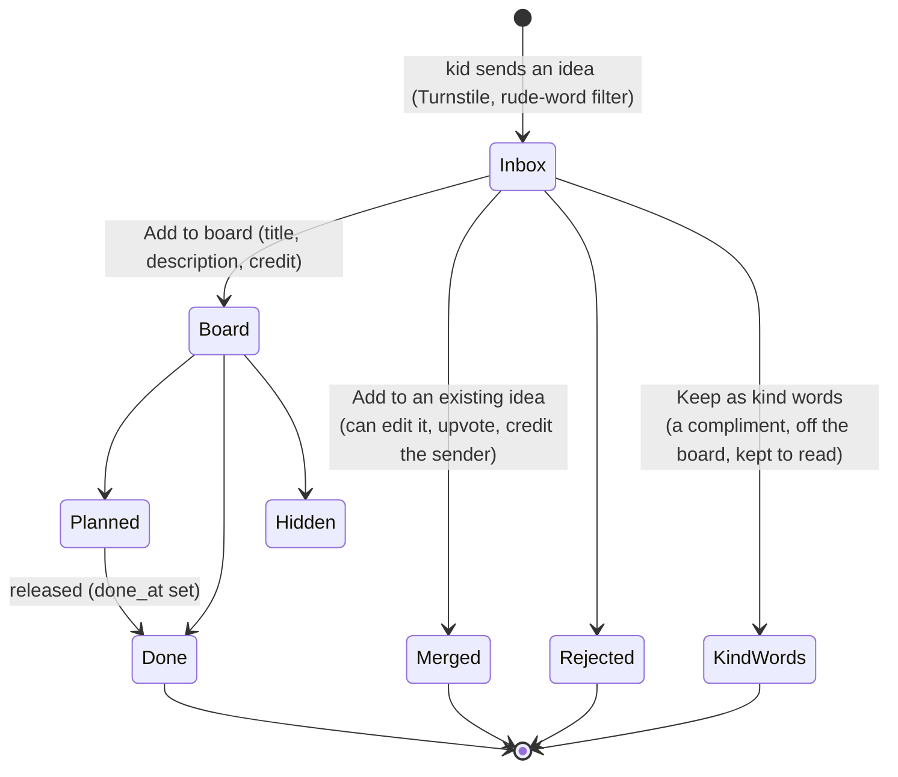

Kids upvote ideas on `/ideas/` (one vote per idea per device). The admin can move an idea to another game or
app, and edit any of its fields.

## The game's screens

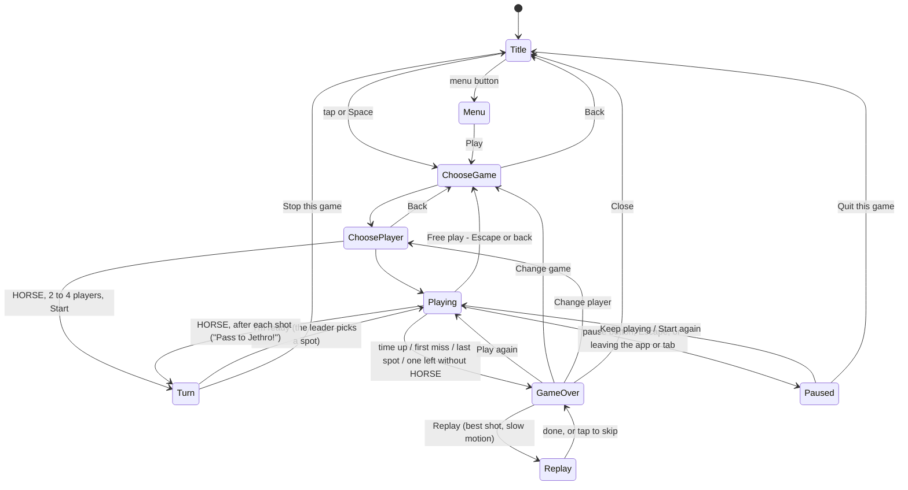

The menu, help, the leaderboard and the shop open over any of these and return to where they were.

In the code these are `state.phase`, and `PHASES` in `play/state.js` lists where each can go (the title is
always allowed); change it only with `setPhase()`, which warns about a move the table doesn't list (an
error in `?debug`). Between Playing and GameOver there's a short `ending` phase: time's up (or the game is
decided), balls already in the air still count, and no new shot can start. A shot can only be taken while
`canShoot()` (playing, not paused), so every ball that can score is in the shot log, and a ball is called
made or missed once: a ball still sitting on the rim isn't called until it drops in (it counts) or
falls off, or just before it's cleared away (5 seconds), and a ball called a miss can't count later. Both keep the
score the game shows equal to the server's recount of its shot log.

**The page is laid out like an app**, the same on the web and in the iOS app (`games/shootaround/index.html`,
the game page section of `styles.css`). There's no site bar: the website's pages are links at the bottom of
the menu, which the iOS app leaves out (`IN_APP`). The page fills the screen inside the safe areas and never
scrolls. The court (`#stage`, a square) is as big as fits in the middle: on a tall screen, less a row of
buttons above and the same space below; on a wide screen, less a column each side. Never less than 85% of
the most that fits, so on a nearly square screen the buttons sit over the court's empty top corners. The
buttons are in the top corners (menu, leaderboard and shop on the left; how to play, music and sound on the
right); mid-game only pause, music and sound stay. Pausing stops the game's update (`state.paused`), so the clock and the ball freeze; quitting sends nothing. The bottom corners are kept free for thumbs and, later, a
joystick and buttons. The score and clock stay on the wall scoreboard in the court art. Every other screen
is a sheet that fills the whole screen, with its heading stuck to the top and back (or close) at the top
left; Escape does the same as that button. The whole page takes presses, so a thumb can hold anywhere
outside the buttons and sheets.

**HORSE (pass and play)** is a mode (`modes/horse.js`) with a few optional hooks no other mode uses
(documented in `modes/index.js`): `passAndPlay` makes choosing a player pick 2 to 4 players in turn order
(the same picker, remembered as `orson-hoops-team`), `setPlayers` and `begin` start it, and between shots
the phase is `turn`, where the game calls the mode's `betweenTurns(dt)` and the turn screen
(`screens/horse.js`) shows who's up, everyone's letters and the spot on a little map of the court. The leader
picks a spot (one is picked at random to start from, from the seeded "spots" stream); if they make it, each
other player still in has to make the same shot or get a letter; a missed lead shot passes the lead on.
Each turn plays as that player without changing the device's chosen player (`useCharacter(id, { remember:
false })`; the title and choose-a-game screens switch back). There's no fire (every shot is the same for
everyone), no bonus balls, no best, no daily challenge and no leaderboard; a finished match does get a start token and earns flat coins
(see saved progress above), so it's counted in the admin's stats like any other game.

## Players' art

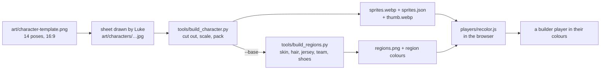

Orson is made from generated videos instead (green screen, one move and direction each, listed in
`art/video/orson.json`):

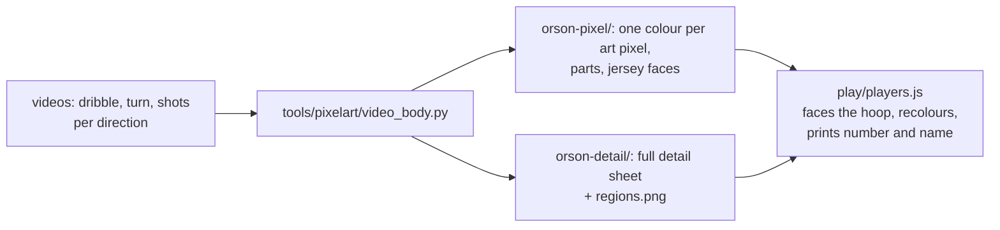

- **Moves per direction:** the game's moves are named by facing (`dribble-bl`, `jump-b`, ...); `faceHoop()`
  picks one of eight ways from where he stands: whichever is nearest the hoop's direction on screen, with
  the diagonals along the court's own lines (flatter than 45°, as the isometric art draws them). A move not
  drawn that way uses the nearest way it is drawn, then the plain name. Orson dribbles back-right, right,
  front-left and front-right from their videos; he shoots front-left from its video, and his back-right,
  right and front-right shots are his back-left, left and front-left shots mirrored.
- **Number and team name:** each frame has a four-cornered face laid on his jersey, smoothed across the
  move; the text is set flat in the pixel font and warped onto it, only where jersey shows
  (`players/pixelkit.js`). The full-detail sheet borrows the faces from its pixel-art twin.
  `tools/dev/check_prints.mjs` checks every frame keeps the print on the jersey.
- **Recolouring:** the full-detail sheet has a `regions.png` like the builder bodies; `?jersey=...&number=`
  on the game URL tries a kit on Orson.
- **Kits: jersey, shorts and trim.** The region map has one "team" region for the jersey's trim and the
  shorts. `recolor()` splits it when a player has `shorts` of their own: team pixels within 4 pixels of the
  jersey are the trim (and the number's ink), the rest the shorts (`shortsMask()`, once per sheet). No
  `shorts` (players made before, the `players` table's null): the shorts are the team colour, as before.
- **Shade ramps** (`players/shades.js`, used by `recolor()` for hair only): the hair's pixels are ranked by
  lightness within each frame (worked out once per sheet, contrast-limited so flat areas don't go blotchy; a
  frame showing little hair leans on the whole sheet's ranks), so hair that's lighter in some video frames
  than others doesn't flicker.
  A chosen colour becomes 6 shades in OKLCH (three shadows, the colour, two highlights; squeezed near black
  or white rather than greyed), and a 256-entry table maps each pixel's lightness to its place on that ramp,
  so black hair keeps its curls and blonde stays blonde. Skin, kit and shoes keep the plain scaling, which
  leaves eyes and freckles drawn on the skin as they are.

### Layered players

Builder players move like Orson by sharing his body: his pixel-art frames with his head taken off, plus
a head per style, at a build (taller or shorter, bulkier or thinner). A head is drawn in ten views: five
facings (front, front-right, right, back-right, back; the left ones are flipped), each normal and looking
up (used in the jump and release of a shot).

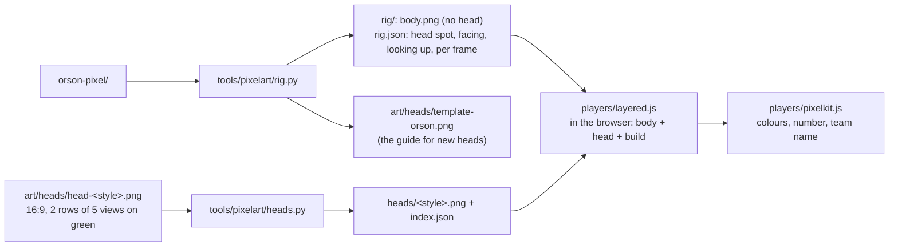

- **Which players:** a builder body whose id has a head in `assets/characters/heads/index.json` becomes
  layered (`loadBuiltPlayers()` in `play/players.js`); the others keep their hand-drawn sheet. So a head
  replaces a body as soon as it's built. `?head=<style>&height=&bulk=` (each -1 to 1) tries one on Orson.
- **Putting one together** happens once when the player loads: each frame is copied into a cell with room
  round it (so long hair isn't cut off), rows added or taken between neck and feet and columns across the
  middle for the build, the head drawn under the body (his shoulders, arms and the ball stay in front), and
  the jersey faces moved to match. About 7 MB in memory per player (Orson's full-detail sheet is about
  100 MB), and a fraction of a second.
- **Taking his head off:** his hair, and the skin joined to it under his hair without crossing a line
  (his face), inside a head-sized circle and the head's usual shape for that view. A raised arm or hand
  by his face is drawn with a line between, so it stays, and is drawn in front of the new head.
- **Heads' placement:** each view's square sits at a fixed offset from the middle of his hair (from a
  guide frame per view); a new head is lined up by its neck with Orson's in the same view.
- **Heads' colours:** hair and skin become the rig's palette slots, shaded with the same share of each
  tone as Orson's own head in that view, so they recolour and shade like the body. Shading browns his art
  shares with the ball are folded into skin and hair (`fold_into_parts()` in `rig.py`).
- **Build** is looks only: the jump, timing and scoring are the same for everyone.

### Kids from video

The builder's Curly and Buns bodies are kids made from their own videos, like Orson (`art/video/curly.json`,
`buns.json`; `curly-detail/`, `buns-detail/`). Their entry in `assets/characters/bases/index.json` has
`video: true` and a `card` (the frame and square for their card picture). The other bodies stay hand-drawn
until each has its videos. Until the `videokids` flag is on (see Feature flags), the builder and the game use
Curly's and Buns' earlier drawn bodies instead (`assets/characters/bases/curly/`, `buns/`).

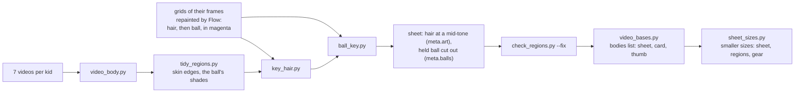

- **Sheet sizes** (`<kid>-detail/sprites@<size>.*`, `gear/<item>/<kid>@<size>.*` stamped in
  `gear/index@<size>.json`, the index entry's `sizes` and `pixels`): the same frames at `small` (2/3) and,
  for a sheet too big for an iOS canvas with gear and the biggest build (Buns), `medium` (4/5). Made by
  `sheet_sizes.py` at the end of `video_bases.py` (and of `gear_key.py` for a layer), so they never go
  stale. A size is only used where it loses nothing: `pickSize()` in `players/recolor.js` takes `k`, the
  screen pixels per full-sheet pixel where it's drawn, and picks the smallest size whose pixels aren't drawn
  enlarged (scale >= k), else full. The game works `k` out from its court's canvas (`gameScale()`; a full
  sheet pixel is 1/0.6 court pixels; `COURT_ZOOM` for a court drawn bigger) and checks again when the court
  is resized (`recheckSheet()`); the builder from its preview (`previewScale()`), its cards always small. On
  iOS a canvas holds at most 16.7 megapixels, so there a sheet that can't fit takes the largest size that
  can. `meta.fullRes` keeps the full sheet's `res`. `?small`, `?medium` and `?full` try a size.
- **Building a player** (`loadBuilt()` in `play/players.js`, `repaint()` in the builder) works on pixels
  already on the CPU: `recolor()` leaves its `ImageData` on its canvas for `wearGear()`, and print layers
  and region canvases are `willReadFrequently`, because drawing a GPU canvas into a CPU one reads the whole
  sheet back each time. Picker and leaderboard faces recolour only their card frame (`thumbnail()`), never
  the whole sheet. The shoes for the fire are found per frame when first needed (`feetIn()` in
  `engine/draw.js`), from the region map, or `meta.feet` on a stretched sheet.
- **Boot** shows the title while the chosen player's sheet loads (`playerReady` in `game.js`); choosing a
  player waits for it, and only the latest one asked for is used.
- **Hair** is stored at a mid-tone with full light and shade, whatever colour the video drew it, so any
  hair colour recolours cleanly; `meta.art.hair` tells `recolor()` the stored colour differs from the kid's
  own. It comes from Flow repainting the hair in shaded magenta on 24-frame grids (free images).
- **The held ball** is the game's own ball: `meta.balls` gives each frame's ball (centre and radius, in the
  frame), cut out of the body and drawn behind it (`drawPlayer()` in `play/scene.js`), so the shop's ball
  styles show in their hands and fingers stay in front. Where Flow moved the ball when repainting it, the
  cut goes on the frame's own ball instead (its colours learnt from the kid's other frames), and a frame
  Flow left unpainted beside one holding the ball is cut too, so the ball never switches between the drawn
  one and the game's.
- **Number and team name** come from the pixel twin's jersey faces (`printsFrom`), placed per frame by
  `video_body.py`: the back's number a set share of the way from shoulders to shorts (a config's
  `face_rows`), a turned move's print moved onto the chest (`face_x`), and a frame whose chest the ball
  hides takes its neighbour's face, so the print doesn't blink.
- **Size:** `players/stretch.js` doubles or drops rows between the jersey's top and the feet and columns
  across the jersey (6% taller or shorter, 10% wider or slimmer at the ends), with the number, team name and
  held ball moved to match. Saved with the player on the device (`build` in `shared/save.js`).
- **Gear** (`content/gear.json`: shoes, head, face, jersey, arms and legs items) is a layer over the kid,
  never part of the body. Flow paints one item per pass onto grids of the kid's frames (greyed shoes and
  shorts, the ball painted back in, from `gear_key.py grids`), its main part in shaded magenta and a second
  colour in shaded bright blue; `gear_key.py build` turns that into `assets/characters/gear/<item>/<kid>`:
  the item's pixels per frame (packed), a part map (gear1, gear2, recoloured from light and shade like
  hair, in the player colours the item names) and the body pixels it hides (hair under a hat).
  `players/gear.js` puts the worn items on the recoloured sheet before height and build, growing frames
  where an item reaches outside them. Items behind the held ball are cut where the ball is; arm items go
  over it; jersey prints go over stripes and under a hoodie. Saved with the player (`gear` in
  `shared/save.js`), picked in the builder's Gear tab ("What you wear", only items made for that kid,
  listed in `assets/characters/gear/index.json`); `?gear=beanie,stripes` tries items in the builder and
  the game.
- Each grid Flow paints holds whole moves (`frame_grids.py --moves`), and a finished grid of the same item
  goes with every prompt as a look reference, so an item can't change shape within a move. A frame Flow
  didn't paint borrows the item from the closest frame facing the same way. Hats hide the hair above them
  (`"hides": "hair"`), so Buns' buns go under a cap or beanie.
- **Kept between visits** (`play/kept.js`): building a kid from video in a player's colours, gear and size
  takes 3-8 s on a phone, so the finished sheet (number and team name drawn in) and its frame list go in
  Cache Storage (`built-players`, the newest 6), named by a hash of the sheet size and that size's sheets'
  stamps, the colours, build, gear (with each layer's stamp, from that size's gear index) and the code that
  builds players (filled in by `vite.config.js`). The frame list carries where the feet are in every frame
  (from the region map, if not stretched), so a kept player needs no region map. A later visit decodes that
  one image off the main thread instead of downloading and building.
- **Moves:** their sheets add `start` (picking the dribble back up) and `recover` (arms down after a shot),
  which the game uses when a sheet has them (`hasMove()` in `play/players.js`).

## How work gets from a session to live

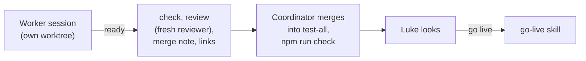

- **`npm run check`** (`tools/dev/check.mjs`): build, Worker tests and types, and house-rule greps (no emoji,
  no native dialogs, new `innerHTML` only with constant text, card stats in `FEATURE_FROM`, a clip for every
  announcer line, no secrets files). `docs/rules.md` pairs each house rule with what enforces it.
- **Skills** (`.claude/skills/`): `verify` (the agent's eyes), `review` (a reviewer that isn't the implementer,
  using `docs/coding-standards.md`), `pr` (the merge note: door, blast radius, before/after; facts from
  `tools/dev/blast_radius.mjs`), `ready`, `coordinate`, `retro` (repeated corrections become checks).
- **Outer loop:** triggers make lists and Luke decides. The weekly digest (`worker/src/digest.ts`, Monday
  cron, before the ntfy nudge) snapshots odd games still unchecked and names with open reports into `digests`;
  the newest unseen one is a card at the top of the admin inbox until "Got it" (`POST /api/admin/digests/:id`).
  It never changes the board. The `ideas-triage` skill writes to the live inbox only on Luke's yes per item;
  the `dependabot` skill checks a Dependabot PR locally and writes a merge note, and Luke merges.
- A `SessionStart` hook (`tools/dev/behind.sh`) says how far a worktree is behind `main` and `test-all`.

## Going live

Database migration first, then the Worker (it may need the new table), then the site (it may need the new
Worker). Details in the `go-live` skill.
